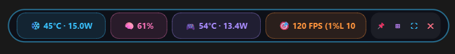
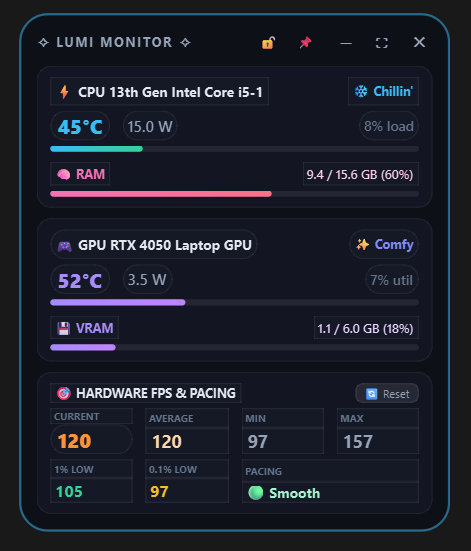
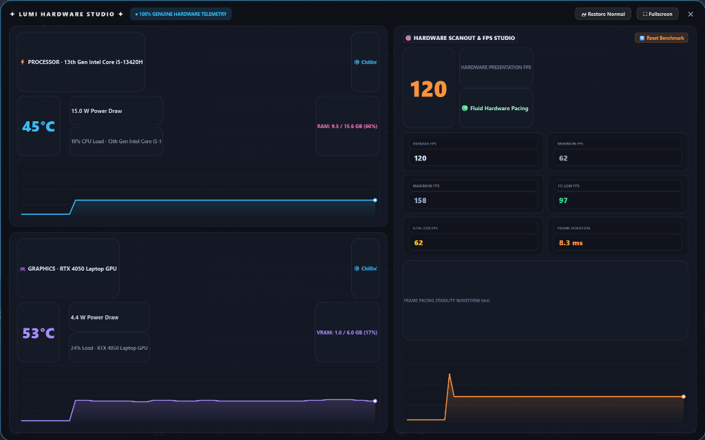

# ✧ LumiHUD ✧
### Cute, Minimal & Powerful Hardware Monitor for Windows 11 / 10

[](https://www.microsoft.com/)
[](https://www.python.org/)
[](https://riverbankcomputing.com/software/pyqt/)
[](LICENSE)
[](#-100-genuine-hardware-data--no-fake-timers)

A sleek, modern, and cute desktop overlay HUD designed for developers, gamers, and benchmarkers. Features true curved pill edges, multi-color dynamic badges, 3 versatile viewing modes, and **100% real hardware telemetry** with sub-0.1% CPU consumption.

---

## 📸 Screenshots & Showcase

<div align="center">
  <h3>💊 Cute Curved Multi-Color Mini Pill Mode</h3>
  
  <p><i>Ultra-slim floating capsule bar with individual color chips for CPU, RAM, GPU, and FPS.</i></p>
</div>

<br/>

<div align="center">
  <table>
    <tr>
      <th align="center">🗂️ Default Compact Floating Overlay</th>
      <th align="center">📺 Big Visual Comfort Studio Dashboard</th>
    </tr>
    <tr>
      <td align="center" valign="middle">
        
        <br/>
        <sub><i>Compact widget with Game Lock <code>[🔒]</code> and Always-on-Top <code>[📌]</code></i></sub>
      </td>
      <td align="center" valign="middle">
        
        <br/>
        <sub><i>Full dashboard with live 60-second waveform history charts</i></sub>
      </td>
    </tr>
  </table>
</div>

---

## ✨ Features at a Glance

* **3 Versatile Views:**
  * **💊 Mini Pill Mode (Dynamic Island):** Single horizontal capsule bar with true circular pill edges and distinct color chips. Fits unobtrusively on any screen edge.
  * **🗂️ Compact Floating Card (Default):** Aesthetic floating widget with quick stats, progress bars, and gaming consistency metrics.
  * **📺 Big Visual Comfort Studio (Fullscreen / 1040 × 650):** Expansive dashboard with 48px large typography and **live 60-second real-time waveform history charts** for CPU temp, GPU temp, and frame pacing.
* **100% Genuine Hardware Telemetry (Zero Fake Data):**
  * Direct hardware scanout vertical blank interrupts (`IDXGIOutput::WaitForVBlank`).
  * Motherboard ACPI Thermal Zone scanning for true CPU temperature.
  * Intel & AMD RAPL hardware package power registers (Wattage).
  * NVIDIA NVML C-library (live wattage, temperature, and deep sleep detection).
  * Windows Kernel Memory Manager (RAM & VRAM).
* **🎮 Full Gaming Overlay Support:**
  * **Win32 `SetWindowPos` TopMost Hooks:** Stays persistently on top of full-screen borderless games (GTA V, Battlefield, Cyberpunk, etc.) without getting buried.
  * **`[🔒]` Game Overlay Lock:** One-click lock to prevent accidental dragging during fast mouse movement and aiming.
  * **`WS_EX_NOACTIVATE`:** Clicking on the overlay will never steal keyboard or controller focus from the game.
* **Full Gaming & Display FPS Suite:**
  * **Current FPS:** Real-time display presentation rate.
  * **Average FPS:** Session mean framerate.
  * **Min & Max FPS:** Peak and drop tracking.
  * **1% Low FPS & 0.1% Low FPS:** Micro-stutter and hitch detection.
  * **Pacing Stability Gauge:** `🟢 Smooth`, `🟡 Mild Hitch`, or `🔴 Stuttering`.
  * **One-Click Benchmark Reset:** Instant session reset for game benchmarking.
* **Universal Multi-Laptop Compatibility:**
  * Dynamically adapts to **Intel Core (10th–14th Gen, Core Ultra)** and **AMD Ryzen (3000–8000 series)**.
  * Supports **NVIDIA RTX/GTX**, **AMD Radeon**, and **Intel Iris Xe / UHD Graphics**.
  * Auto-detects display refresh rates: **60 Hz, 120 Hz, 144 Hz, 165 Hz, 240 Hz, 360 Hz**.
* **Cute & Reactive Design:**
  * **❄️ Chillin' (<52°C)** $\rightarrow$ **✨ Comfy (52–65°C)** $\rightarrow$ **⚡ Working (65–75°C)** $\rightarrow$ **🔥 Toasty (75–85°C)** $\rightarrow$ **♨️ Spicy! (>85°C)**.
  * Dedicated GPU automatically displays **`💤 Snoozin'`** when asleep (0.0 W) and wakes up to **`🎮 Active`** under load.
  * Draggable anywhere, always-on-top toggle (`📌`), and fluid 30 FPS glow animations.

---

## 🚀 Super Simple 1-Click Installation (Any PC / Laptop)

Designed for zero effort on any Windows 10/11 laptop:

### Option 1: 1-Click Automatic Setup (Recommended)
1. **Download or Clone** this repository to your laptop.
2. Double-click **`Setup_And_Run.bat`**.
   * It checks for Python (installs it automatically via `winget` if missing).
   * Installs the required packages quietly.
   * Creates a **`LumiHUD` shortcut right on your Desktop**.
   * Launches LumiHUD immediately!

---

### Option 2: Manual Setup (For CLI Users)
If you already have Python installed:
```bash
git clone https://github.com/yashwantmandal26/LumiHUD.git
cd LumiHUD
pip install -r requirements.txt
pythonw monitor.py
```

---

## 🕹️ Controls & Shortcuts

| Shortcut / Action | Function |
| :--- | :--- |
| **`[🔒]` / `[🔓]`** | **Game Lock:** Lock/unlock HUD position during gaming |
| **`[⎯]` button** or **Double-Click** | Switch to **Mini Pill Mode** (sleek horizontal capsule) |
| **`[⊞]` button** or **Double-Click** | Return to **Compact Card Widget** (default view) |
| **`[⛶]` button** or **`F11`** | Expand to **Big Visual Comfort Studio / Fullscreen** |
| **`ESC` key** | Instantly return from Big Studio to Compact Card |
| **`[📌]` Pin** | Toggle **Always-on-Top** |
| **`[🔄 Reset]`** | Reset FPS, Min, Max, and 1% Low benchmark history |
| **Left Click + Drag** | Drag and position widget anywhere on your screen |

---

## 🔬 100% Genuine Hardware Data — No Fake Timers

Unlike basic overlays that estimate frame rates using synthetic `time.sleep()` loops, **LumiHUD measures physical hardware signals**:

* **Physical Display Interrupts:** Calls DirectX `IDXGIOutput::WaitForVBlank`, blocking until the GPU's scanout hardware fires the vertical blanking interrupt. Timed with sub-microsecond `time.perf_counter_ns()`.
* **ACPI Thermal Scanning:** Enumerates `\Thermal Zone Information(*)\High Precision Temperature` on the motherboard and monitors the hottest active core.
* **Silicon Power Registers (RAPL):** Queries `\Energy Meter(*)\Power` directly from the CPU package power limit counters.
* **Zero System Overhead:** Consumes less than **0.1% CPU**, keeping your laptop completely cool and stutter-free while coding or gaming.

---

## 📁 Repository Structure

```
LumiHUD/
├── assets/                 # Screenshots & visual assets
│   ├── compact_card.png    # Default floating card screenshot
│   ├── mini_pill.png       # Cute curved mini pill screenshot
│   └── studio_dashboard.png# Big visual comfort dashboard screenshot
├── monitor.py              # Core application (PyQt6 HUD + DXGI & PDH engines)
├── Setup_And_Run.bat       # 1-Click automated installer & desktop shortcut creator
├── Run_Monitor.bat         # Fast silent launcher (pythonw)
├── Stop_Monitor.bat        # Clean process terminator
├── requirements.txt        # Minimal dependencies (PyQt6, psutil, pywin32)
├── LICENSE                 # MIT Open-Source License
└── README.md               # Documentation & showcase
```

---

## 📄 License
This project is licensed under the [MIT License](LICENSE). Free for personal and commercial use.
